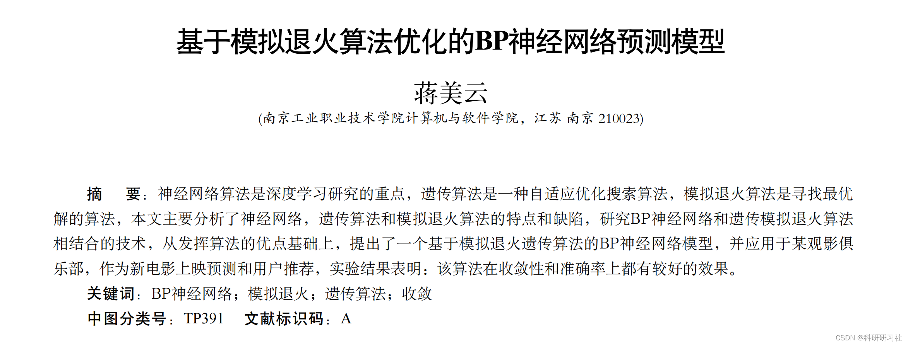
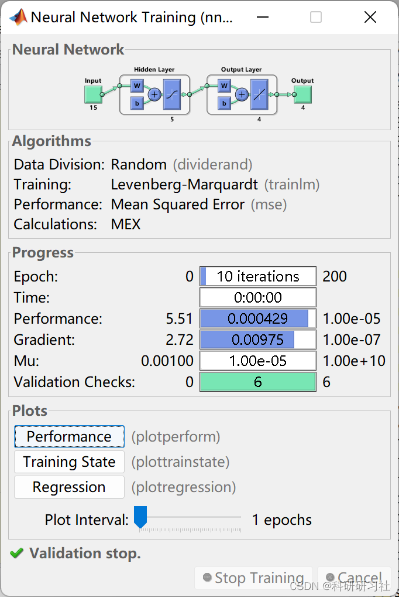
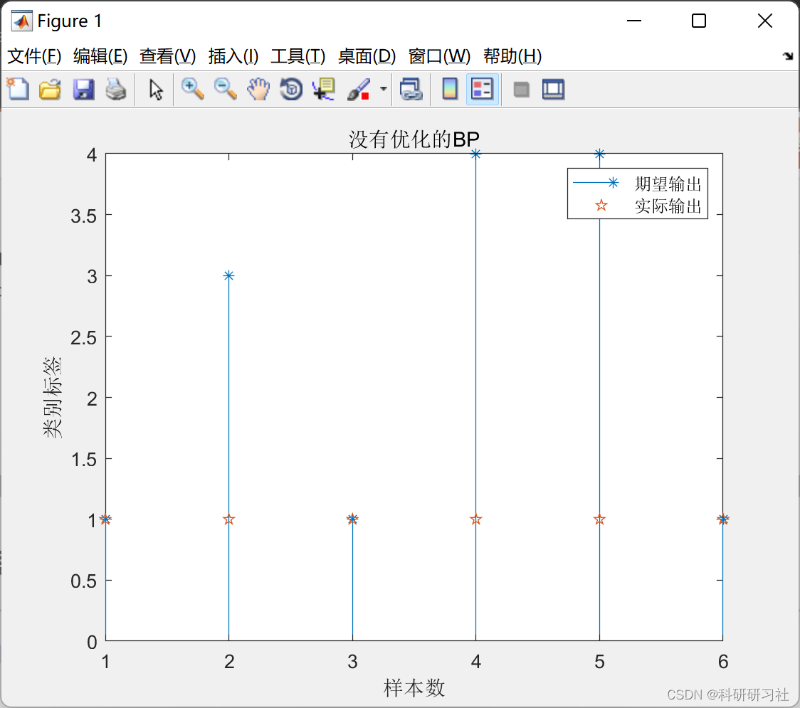
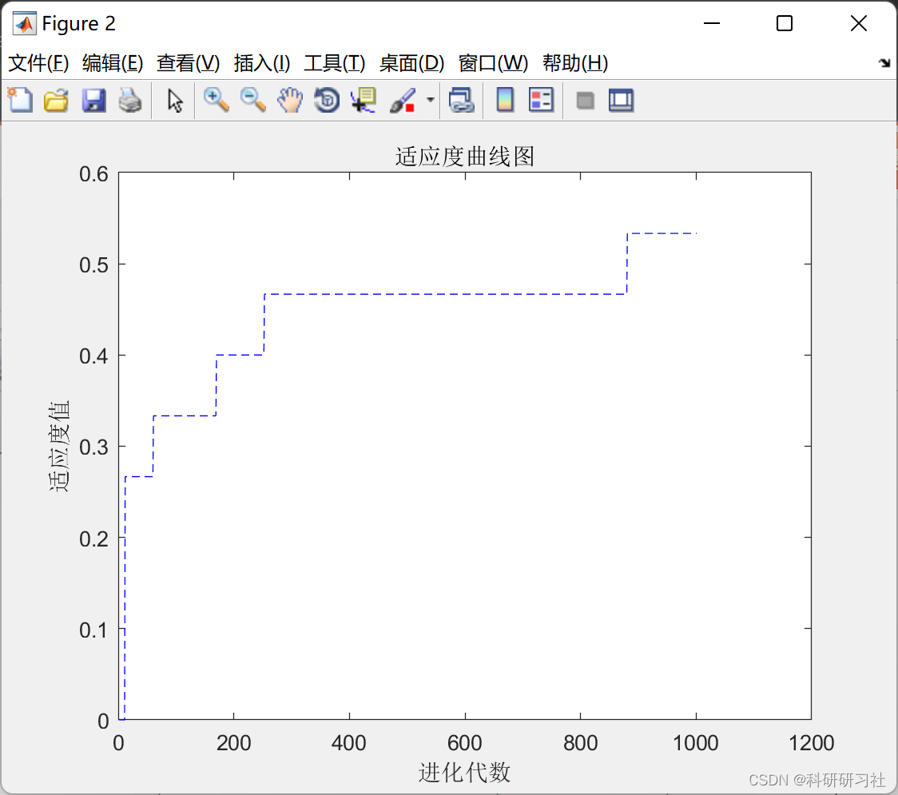
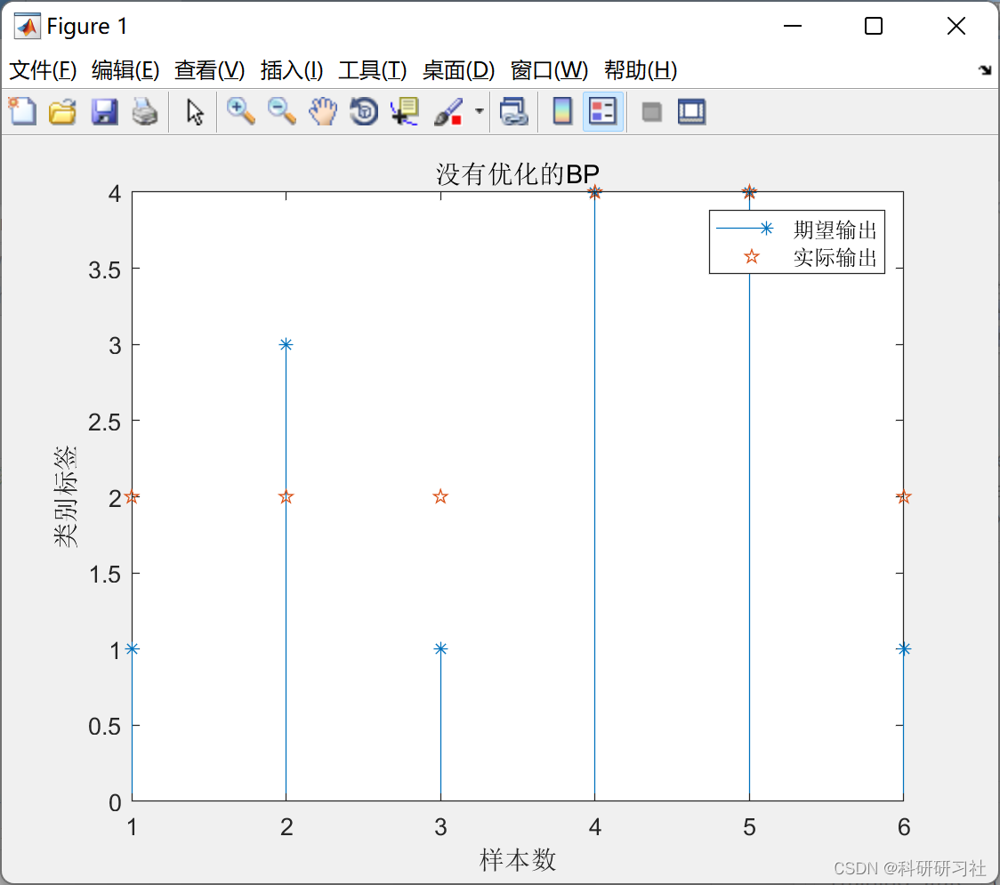
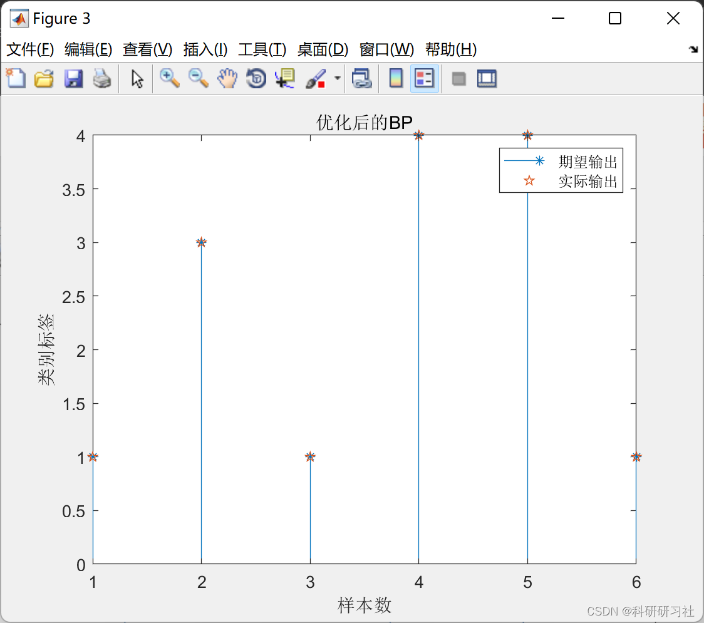

# BP Neural Network Prediction Model Optimized by Simulated Annealing Algorithm (Matlab Code Implementation)

1. Overview
The simulated annealing algorithm (SA) starts from a high temperature and gradually decreases the temperature parameter, while simultaneously randomly searching for the global optimal solution in the solution space through the probability of sudden jump characteristics.
Due to the issues such as local minima and slow convergence speed of the Backpropagation (BP) neural network, this paper proposes a simulated annealing genetic algorithm-optimized BP neural network model based on the optimization algorithms GA and SA. By combining these two methods, the use of SA can avoid the premature convergence problem of GA, thereby enhancing both global and local search capabilities. This paper proposes an optimized BP neural network algorithm using the simulated annealing genetic algorithm and establishes a model for prediction.
2. Simulated Annealing-Based BP Neural Network
Utilizing the simulated annealing algorithm [3] to optimize the genetic algorithm and leveraging the global search capability of the genetic algorithm, we obtain the optimal population (weights and thresholds) each time. Then, utilizing the local search feature of BP, we reversely find the optimal value.
3. Knowledge Review
[BP Prediction] Data regression prediction based on the genetic algorithm-optimized BP neural network (Matlab code implementation)
[DP Optimization] Data prediction based on Emperor Penguin Algorithm-optimized BP neural network (Matlab code implementation)
[Neural Network Prediction Research] Optimization of neural network prediction by cultural algorithm (Matlab code implementation)
[Regression Prediction - BP Prediction] Application of Backpropagation Algorithm-optimized BP neural network in nonlinear function fitting (Matlab code implementation)
4. Matlab Code and Article Reading
This article only showcases part of the code, all codes and articles are available in:
Simulated Annealing-Optimized BP Neural Network Prediction Model (Matlab code implementation)
function [h,trace]=saforbp(inputnum,hiddennum,outputnum,inputn_train,label_train,net)\n%% Parameter setting\n%%% Cooling Table Parameters %%%%%%%%%%\nL=10;      % Markov chain length\nK=0.9;    % Decay factor\nS=0.01;     % Step size factor\nT=100;      % Initial temperature\nP=0;        %Total acceptance points in the Metropolis process\nmax_iter=100;%Maximum number of annealing iterations\n% Generate 10 initial values randomly and select the optimal solution from these 10 values.\nXs=1;\nXx=0;\npop=20;\nD=inputnum*hiddennum+hiddennum+hiddennum*outputnum+outputnum;\nPrex=(rand(D,pop)*(Xs-Xx)+Xx);\nfor i=1:pop\n   funt(i)=fun(Prex(:,i)',inputnum,hiddennum,outputnum,inputn_train,label_train,net); \nend\n[sort_val,index_val] = sort(funt,'descend');\nPrebestx=Prex(:,index_val(end));\nPrex=Prex(:,index_val(end-1));\nBestx=Prex;\nbestfit=zeros(1,max_iter);\n% Each iteration of the annealing process (cooling down) is performed until the iteration conditions are met.\nfor iter=1:max_iter\n    iter\n    T=K*T;% Iteration count at the current temperature T\n    for i=1:L\n        % Select a random point nearby\n        Nextx=Prex+S*(rand(D,1)*(Xs-Xx)+Xx);\n        % Boundary condition handling\n        for ii=1:D\n            if Nextx(ii)>Xs | Nextx(ii)<Xx\n                Nextx(ii)=rand*(Xs-Xx)+Xx;\n            end\n        end\n        %% Whether it is the global optimal solution\n        a=fun(Bestx',inputnum,hiddennum,outputnum,inputn_train,label_train,net); \n        b=fun(Nextx',inputnum,hiddennum,outputnum,inputn_train,label_train,net); \n        if a<b\n           prebest=a;\n           Prebestx=Bestx;%Preserve the previous optimal solution\n           Bestx=Nextx;% Update the optimal solution\n           a=b;\n        end%If a new solution is better, replace the optimal solution with the new one, and the original optimal solution becomes the previous optimal solution.\n%%%%%%%%%%%%Metropolis process\n        c=fun(Prex',inputnum,hiddennum,outputnum,inputn_train,label_train,net); \n        if c<b \n            %%% Accept new solutions\n            Prex=Nextx;\n            P=P+1;\n        else\n            changer=-1*(b-c)/T;\n            p1=exp(changer);\n            %%%Accepting worse solutions with a certain probability\n            if p1>rand\n                Prex=Nextx;\n                P=P+1;\n            end\n        end\n       trace(P+1)=a;    \n    end\nend\nh=Bestx';\nend\n%\n  
5 Running Results Editing
Editing
Editing
Editing
Editing

## Images

<!-- PAYMENT_BLOCK -->

## Get this dataset

- Payment link (Stripe): [Buy now](https://buy.stripe.com/3cs8yP7sY87d0vu9AB)
- Payment QR code: 

<!-- /PAYMENT_BLOCK -->
